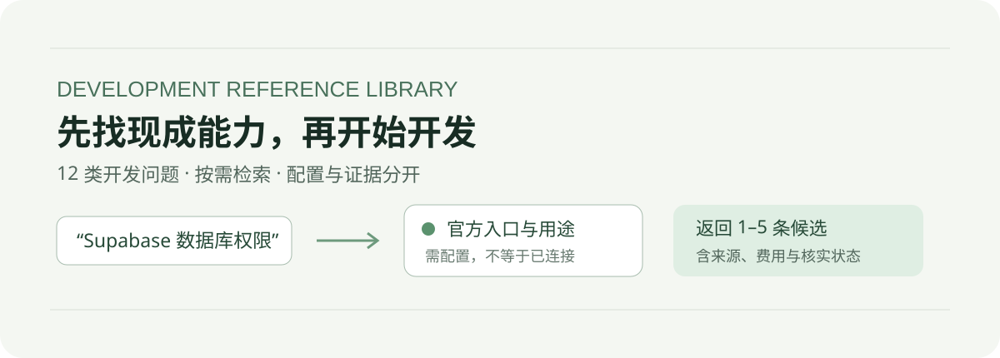

# development-reference-library



按任务检索的开发参考库，供 AI 查找官方文档、能力（Skill / MCP / CLI）、服务与 API 入口。它返回少量候选和核实状态，不是链接收藏夹，也不代替项目源码阅读。

## 命令

```bash
# 自然语言检索，默认 3 条，最多 5 条
py -3 scripts/references.py search "Supabase 数据库权限"
py -3 scripts/references.py search "Next.js 部署" --limit 2
py -3 scripts/references.py search "网页浏览器测试" --json

# 过滤
py -3 scripts/references.py search "数据库" --category 后端数据 --kind mcp
py -3 scripts/references.py search "部署" --category git-deploy

# 校验目录
py -3 scripts/references.py check
py -3 scripts/references.py check --json

# 离线测试
py -3 -m unittest discover -s tests -p "test_*.py" -v
```

## 内容

- `catalog.json`：12 个开发分类与 25 条精选条目，字段固定，状态只使用 `verified / needs_setup / reference_only / caution / unavailable`。
- 检索匹配名称、别名、任务、分类与说明，支持中文连续输入；无结果时明确返回空，不生成条目。
- 输出包含调用方式、配置条件、费用与许可、状态、核实日期和来源。

## 配置边界

- 本库不安装技能、不登录、不调用需要密钥或会产生费用的服务。
- `verified` 只表示官方入口已核实，不代表已登录或已调用云资源。
- 费用与许可未知的条目标为 `unknown`，以官方页面为准。
- 不保存密钥、cookie 或 token，不包含爬虫与批量安装命令。

## 维护

新增条目时补齐 `id,name,kind,categories,tasks,aliases,homepage,access,setup,cost,license,status,last_verified,evidence,notes`，更新 `updated_at`，再跑 `check` 与测试。状态跟着核实程度走，证据必须带 URL 和核对日期。

## 安装与许可

```bash
npx skills add hayou2002/development-reference-library
```

[MIT](LICENSE)
